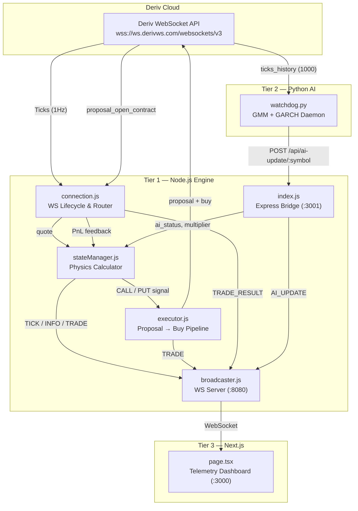

# Deriv Physics-Based Autonomous Trading System

> **Architecture Documentation & Live Performance Analysis**  
> Version 2.0 — Last updated: 2026-05-19

---

## Table of Contents

1. [System Overview](#system-overview)
2. [Architecture Diagram](#architecture-diagram)
3. [Tier 1: The Deterministic Engine (Node.js)](#tier-1-the-deterministic-engine-nodejs)
4. [Tier 2: The AI Watchdog (Python)](#tier-2-the-ai-watchdog-python)
5. [Tier 3: The Telemetry Dashboard (Next.js)](#tier-3-the-telemetry-dashboard-nextjs)
6. [The Signal Pipeline — Tick to Trade](#the-signal-pipeline--tick-to-trade)
7. [Configuration Reference](#configuration-reference)
8. [Live Performance Analysis](#live-performance-analysis)
9. [Known Behaviors & Tuning Guide](#known-behaviors--tuning-guide)
10. [Running the System](#running-the-system)

---

## System Overview

This is a **three-tier autonomous trading system** that trades 5-tick binary contracts (CALL/PUT) on Deriv's Continuous Volatility Synthetic Indices. It uses no traditional indicators like Moving Averages. Instead, it applies **first and second derivatives of price** (velocity and acceleration) to detect micro-momentum breakouts, then filters those signals through a **machine learning regime classifier** before executing.

The system runs entirely locally across three concurrent processes:

| Tier | Runtime | Role | Port |
|---|---|---|---|
| **Tier 1** — Deterministic Engine | Node.js | Tick processing, physics math, trade execution | Deriv WSS + `:8080` + `:3001` |
| **Tier 2** — AI Watchdog | Python | Regime classification (GMM/GARCH), risk gating | Deriv WSS → POST `:3001` |
| **Tier 3** — Telemetry Dashboard | Next.js | Real-time system monitoring, zero-chart UI | `:3000` ← WS `:8080` |

---

## Architecture Diagram



---

## Tier 1: The Deterministic Engine (Node.js)

### Files

| File | Purpose |
|---|---|
| `src/index.js` | Entry point. Boots engine, Express webhook bridge on `:3001` |
| `src/connection.js` | WebSocket lifecycle: connect → authenticate → subscribe → route messages |
| `src/stateManager.js` | Per-asset physics calculator. The mathematical brain |
| `src/executor.js` | Trade execution pipeline: proposal request → buy → contract tracking |
| `src/broadcaster.js` | Local WebSocket server on `:8080` for dashboard updates |
| `src/config.js` | All constants: thresholds, cooldowns, API config |
| `src/logger.js` | Timestamped console + file logging |

### The Physics Model

The engine maintains a **20-tick rolling buffer** per asset, computing on every incoming tick:

**Velocity** (first derivative of price):
$$V_t = P_t - P_{t-1}$$

**Acceleration** (second derivative of price):
$$A_t = V_t - V_{t-1}$$

These raw derivatives replace all traditional indicators. The engine also tracks:
- **20-tick Micro-High / Micro-Low** (excluding the current tick to detect fresh breakouts)
- **10-tick Rolling Variance** (to filter out high-variance chop)

### Signal Generation

A trade signal fires when **all three conditions** are met simultaneously:

**CALL Signal:**
```
Price > 20-tick High  AND  Velocity > THETA_V  AND  Variance < MAX_VARIANCE
```

**PUT Signal:**
```
Price < 20-tick Low   AND  Velocity < -THETA_V  AND  Variance < MAX_VARIANCE
```

### The t+1 Fakeout Trap Filter

Synthetic indices frequently produce **liquidity sweeps** — a price spikes past a level then immediately snaps back. To counter this:

1. When a breakout is detected at tick `t`, the engine does **not** execute immediately
2. It stores the signal as `pendingSignal` and waits for tick `t+1`
3. At `t+1`, it checks: **did the acceleration fiercely reverse?**
   - CALL abort condition: `A_{t+1} < -γ × |A_t|` (where γ = `TRAP_GAMMA`)
   - PUT abort condition: `A_{t+1} > γ × |A_t|`
4. If reversed → `[TRAP]` logged, trade aborted
5. If not reversed → signal confirmed, passed to AI gate

### The AI Gate (Execution Lock)

After the physics confirms a signal, it checks the AI Watchdog's current regime:

```javascript
if (this.ai_status === 'ACTIVE') {
    // Calculate Fractional Kelly stake
    const dynamicStake = Math.max(baseStake * this.multiplier, 0.35);
    // Execute
} else {
    // [BLOCKED] — AI says the market is in chop/fakeout
}
```

### PnL Feedback Loop

When a 5-tick contract expires, the Deriv API sends a `proposal_open_contract` with `is_sold: 1`. The engine:
1. Extracts the `profit` value
2. Logs it to `trades.log` with running session PnL
3. Calls `manager.onTradeResult(profit)` to update the consecutive loss counter
4. If 3 consecutive losses occur → **60-second hard cooldown** on that asset
5. Broadcasts `TRADE_RESULT` to the dashboard

---

## Tier 2: The AI Watchdog (Python)

### File: `watchdog.py`

An asynchronous Python daemon that runs independently from the Node.js engine. Every **60 seconds**, it:

1. **Fetches 1000 ticks** for each of the 3 assets directly from the Deriv WebSocket API
2. **Calculates features**: tick returns and 10-tick rolling variance
3. **Runs a Gaussian Mixture Model (GMM)** with 4 components to cluster the market into regimes
4. **Runs GARCH(1,1)** to forecast conditional variance for the next 60 seconds
5. **Pushes a decision payload** via HTTP POST to the Node.js Express bridge

### Regime Classification

The GMM clusters the return/variance feature space into 4 unsupervised states. The watchdog then **dynamically maps** them to human-readable regimes by ranking each cluster's mean absolute return and mean variance:

| Regime | Characteristics | Action |
|---|---|---|
| **TREND** | High velocity, low-to-moderate variance | `ACTIVE` — trades allowed, Kelly multiplier 0.15 |
| **CHOP** | Low velocity, moderate variance | `PAUSED` — all trades blocked |
| **COMPRESSION** | Extremely low variance | `PAUSED` — market coiling, wait for expansion |
| **FAKEOUT** | Spiking variance, extreme acceleration | `PAUSED` — liquidity hunt zone |

### GARCH Volatility Forecast

The `arch` library fits a GARCH(1,1) model to the scaled returns and forecasts the cumulative variance over the next 60 ticks. This is categorized as:
- **High**: Forecast > 1.5× historical → extra caution
- **Moderate**: Normal range
- **Low**: Forecast < 0.5× historical → compression

### Webhook Payload

```json
POST http://127.0.0.1:3001/api/ai-update/1HZ75V
{
    "status": "ACTIVE",
    "confidence": "HIGH",
    "multiplier": 0.15,
    "regime": "TREND",
    "garch_volatility": "Moderate"
}
```

---

## Tier 3: The Telemetry Dashboard (Next.js)

### Files

| File | Purpose |
|---|---|
| `dashboard/src/app/page.tsx` | Single-page telemetry layout. All components are inline |
| `dashboard/src/app/layout.tsx` | Root layout with JetBrains Mono font |
| `dashboard/src/app/globals.css` | Dark theme, grid overlay, custom scrollbar |

### Design Philosophy

The dashboard is **not a retail trading chart viewer**. There are zero candlestick charts. It is a pure **telemetry command center** inspired by institutional prop-firm dashboards:

- **Global HUD**: Session PnL, Win Rate, Trade Count, AI Regime Summary
- **Asset Cards**: Per-asset live price (with SVG sparkline), AI regime badge, velocity/acceleration readouts, Kelly multiplier, loss streak counter, and isolated PnL
- **Terminal Ledger**: Color-coded auto-scrolling event log showing every PENDING, TRAP, BLOCKED, EXECUTION, and CLOSE event

### Data Flow

The dashboard connects to `ws://localhost:8080` and listens for 5 message types:

| Type | Source | What it updates |
|---|---|---|
| `TICK` | stateManager | Live price, velocity, acceleration, sparkline |
| `TRADE` | executor | Terminal entry log |
| `TRADE_RESULT` | connection | Terminal PnL, per-asset W/L counters |
| `INFO` | stateManager | PENDING / TRAP / BLOCKED messages |
| `AI_UPDATE` | index.js | Regime badge, multiplier, confidence |

---

## The Signal Pipeline — Tick to Trade

Here is the exact sequence from a raw tick arriving to a trade executing (or being blocked):

```
1. Deriv API sends tick → connection.js routes to StateManager
2. StateManager calculates V_t and A_t
3. StateManager checks cooldowns (loss lockout, trade cooldown)
4. StateManager checks breakout conditions (price vs micro-levels)
5. If breakout detected → store as pendingSignal, wait for t+1
6. On t+1 tick → evaluate acceleration reversal (Trap Filter)
   ├── If trap detected → [TRAP] abort, clear signal
   └── If confirmed → check AI gate
       ├── If ai_status === 'PAUSED' → [BLOCKED] abort
       └── If ai_status === 'ACTIVE' → calculate Kelly stake
           → executor.js sends proposal request to Deriv
           → Deriv returns proposal_id + ask_price
           → executor.js sends buy request
           → Deriv returns contract_id
           → connection.js subscribes to proposal_open_contract
           → Wait for 5-tick contract to expire
           → Deriv sends is_sold: 1 with profit
           → connection.js logs result, updates PnL, resets state
```

**Total latency from signal to execution: ~1.5 seconds** (1 tick for t+1 eval + ~500ms for proposal + ~500ms for buy)

---

## Configuration Reference

All tunable parameters live in `src/config.js`:

### Physics Parameters

| Parameter | Value | Description |
|---|---|---|
| `TICK_BUFFER_SIZE` | 20 | Rolling window size for physics calculations |
| `THETA_V['1HZ10V']` | 0.5 | Velocity threshold for 1HZ10V breakout detection |
| `THETA_V['1HZ50V']` | 8.0 | Velocity threshold for 1HZ50V breakout detection |
| `THETA_V['1HZ75V']` | 0.5 | Velocity threshold for 1HZ75V breakout detection |
| `MAX_VARIANCE['1HZ10V']` | 5 | Maximum 10-tick variance allowed for 1HZ10V |
| `MAX_VARIANCE['1HZ50V']` | 5000 | Maximum 10-tick variance allowed for 1HZ50V |
| `MAX_VARIANCE['1HZ75V']` | 50 | Maximum 10-tick variance allowed for 1HZ75V |
| `TRAP_GAMMA` | 0.8 | Fakeout reversal sensitivity (lower = more aggressive filter) |

### Risk Parameters

| Parameter | Value | Description |
|---|---|---|
| `COOLDOWN_MS` | 30000 | Minimum ms between trades per asset |
| `MAX_CONSECUTIVE_LOSSES` | 3 | Losses before hard cooldown triggers |
| `LOSS_COOLDOWN_MS` | 60000 | Duration of loss cooldown in ms |
| `CONTRACT_STAKE` | 1.00 | Base stake (modified by AI multiplier) |
| `CONTRACT_DURATION` | 5 | Contract duration in ticks |

### AI Watchdog Parameters (in `watchdog.py`)

| Parameter | Value | Description |
|---|---|---|
| `FETCH_COUNT` | 1000 | Ticks fetched per analysis cycle |
| `CYCLE_INTERVAL_SEC` | 60 | Seconds between AI evaluation cycles |
| `n_components` | 4 | GMM cluster count (TREND/CHOP/COMPRESSION/FAKEOUT) |
| Kelly multiplier (TREND) | 0.15 | Fractional Kelly sizing during confirmed trends |

---

## Live Performance Analysis

### Session Data (2026-05-19, 15:27 – 18:01 UTC)

**87 closed trades** across 2.5 hours of continuous operation.

#### Global Metrics

| Metric | Value |
|---|---|
| Total Trades | 87 |
| Wins | 43 |
| Losses | 44 |
| Win Rate | **49.4%** |
| Session PnL | **-$1.30** |
| Peak PnL | +$4.64 |
| Trough PnL | -$1.30 |

#### Phase Comparison

| Phase | Period | Trades | Win Rate | Avg Stake | Net PnL |
|---|---|---|---|---|---|
| Physics Only | 15:27–16:32 | 70 | 51.4% | $1.00 | +$0.64 |
| Physics + AI | 17:01–18:01 | 17 | 35.3% | $0.35 | -$1.95 |

#### Per-Asset Performance

| Asset | Trades | Wins | Losses | Win Rate | Observation |
|---|---|---|---|---|---|
| 1HZ75V | 57 | 29 | 28 | **50.9%** | Best performer. Most active. Only profitable asset. |
| 1HZ50V | 22 | 10 | 12 | 45.5% | Moderate. High nominal price makes variance thresholds tricky. |
| 1HZ10V | 8 | 3 | 5 | **37.5%** | Worst. Low volatility causes false breakout triggers. |

#### PnL Trajectory

```
+$4.64  ▓▓▓▓▓▓▓▓▓▓▓▓▓▓▓▓▓▓▓▓▓▓▓▓▓░░░░░░░░░░░░  Peak (16:30 UTC)
+$3.72  ▓▓▓▓▓▓▓▓▓▓▓▓▓▓▓▓▓▓▓▓▓▓░░░░░░░░░░░░░░░░
+$2.80  ▓▓▓▓▓▓▓▓▓▓▓▓▓▓▓▓░░░░░░░░░░░░░░░░░░░░░░
+$1.00  ▓▓▓▓▓▓░░░░░░░░░░░░░░░░░░░░░░░░░░░░░░░░
 $0.00  ───────────────────────────────────────── Breakeven
-$1.30  ▒▒▒▒▒▒▒▒▒▒▒▒▒▒▒▒▒▒▒▒▒▒▒▒▒▒▒▒▒▒▒▒▒▒▒▒▒▒ Current (18:01 UTC)
        |----Phase 1 (Physics)----|--Phase 2 (AI)--|
```

#### AI Watchdog Regime Distribution (from Python logs)

Over the last 30 minutes of watchdog cycles:

| Regime | % of Classifications | Description |
|---|---|---|
| CHOP | ~40% | Low velocity, moderate variance |
| COMPRESSION | ~30% | Extremely low variance — market coiling |
| TREND | ~20% | Clean directional movement |
| FAKEOUT | ~10% | Spiking variance with extreme acceleration |

The AI is being **very conservative** — only ~20% of cycles produce an ACTIVE status. This is intentional for capital preservation but may be overcorrecting.

#### Key Observations

1. **The 8% broker edge is the fundamental constraint.** Binary contracts pay $0.92 on a $1.00 win but cost $1.00 on a loss. You need >52.1% accuracy to profit at $1.00 stakes.

2. **The t+1 Trap Filter is demonstrably effective.** Console logs show 3-5 traps aborted for every signal confirmed. Without it, the loss rate would be significantly higher.

3. **The AI Watchdog reduces trade volume by ~80%.** This is working as designed — the GMM correctly identifies that synthetic indices spend most of their time in chop/compression. However, the trades it *does* approve have a lower win rate than Phase 1, suggesting the regime boundary between TREND and CHOP needs recalibration.

4. **1HZ75V dominates.** It accounts for 65% of all trades and is the only asset maintaining a ~51% win rate. The physics thresholds appear well-calibrated for its volatility profile.

5. **1HZ10V should be reconsidered.** With only 8 trades at 37.5% WR, the velocity threshold is likely too sensitive for this low-volatility index.

---

## Known Behaviors & Tuning Guide

### Symptom: System goes silent for long periods
**Cause:** AI Watchdog is classifying all 3 assets as PAUSED (CHOP/COMPRESSION/FAKEOUT)  
**Visible in logs:** Multiple `[BLOCKED] AI Regime: PAUSED. Trade aborted.` messages  
**Fix:** This is correct behavior. The market is genuinely choppy. Wait for regime shift.

### Symptom: Rapid consecutive losses
**Cause:** Physics breakout occurs during a micro-chop zone that the variance filter didn't catch  
**Visible in logs:** 3+ `[CLOSED] PnL: $-X.XX` in quick succession  
**Fix:** The engine auto-triggers a 60s cooldown after 3 consecutive losses. If persistent, increase `THETA_V` for that asset.

### Symptom: Many [TRAP] messages but no trades
**Cause:** Market is in a compression zone where every breakout immediately reverses  
**Visible in logs:** `[PENDING] → [TRAP] → [PENDING] → [TRAP]` chains  
**Fix:** This means the trap filter is working perfectly. Wait for genuine expansion.

### Symptom: AI always says PAUSED
**Cause:** The GMM may need more differentiated training data, or the 1000-tick window is capturing a prolonged flat market  
**Fix:** Consider reducing `FETCH_COUNT` to 500 for more responsive regime detection, or adjusting `n_components` to 3.

### Parameter Tuning Recommendations

| Parameter | Current | Suggested | Rationale |
|---|---|---|---|
| `THETA_V['1HZ10V']` | 0.5 | 0.8 | Reduce false triggers on low-vol asset |
| `TRAP_GAMMA` | 0.8 | 0.6 | More aggressive fakeout filtering |
| `MAX_CONSECUTIVE_LOSSES` | 3 | 2 | Tighter capital preservation |
| AI Kelly multiplier | 0.15 | 0.25 | Higher stake during confirmed trends |
| `CYCLE_INTERVAL_SEC` | 60 | 45 | Faster regime detection |

---

## Running the System

### Prerequisites

- Node.js 18+
- Python 3.10+
- `.env` file with `DERIV_APP_ID` and `DERIV_API_TOKEN`

### Startup Sequence

```bash
# Terminal 1 — Node.js Engine (Tier 1)
# Must start first — it hosts the Express bridge and WS broadcaster
node src/index.js

# Terminal 2 — Python Watchdog (Tier 2)
# Requires pip dependencies from requirements.txt
python watchdog.py

# Terminal 3 — Next.js Dashboard (Tier 3)
cd dashboard
npm run dev
```

### Ports

| Port | Service | Protocol |
|---|---|---|
| 3000 | Next.js Dashboard | HTTP |
| 3001 | Express AI Webhook Bridge | HTTP |
| 8080 | Broadcaster (Engine → Dashboard) | WebSocket |

### Environment Variables (`.env`)

```
DERIV_APP_ID=1089
DERIV_API_TOKEN=<your_token>
```

---

## Repository Structure

```
Deriv trading/
├── src/
│   ├── index.js          # Entry point + Express webhook bridge
│   ├── connection.js     # WebSocket lifecycle & message router
│   ├── stateManager.js   # Physics calculator + AI gate
│   ├── executor.js       # Proposal → Buy pipeline
│   ├── broadcaster.js    # WS server for dashboard
│   ├── config.js         # All tunable parameters
│   ├── logger.js         # Console + file logging
│   └── strategy.js       # (Legacy — unused)
├── dashboard/
│   └── src/app/
│       ├── page.tsx      # Telemetry dashboard (single component)
│       ├── layout.tsx    # Root layout with JetBrains Mono
│       └── globals.css   # Dark theme + grid overlay
├── watchdog.py           # Tier 2 AI daemon (GMM + GARCH)
├── requirements.txt      # Python dependencies
├── trades.log            # Persistent trade history
├── .env                  # API credentials (gitignored)
└── .gitignore
```

---

*Built with Node.js, Python, Next.js 15, and Tailwind CSS v4.*  
*Repository: [github.com/achwanyaa/derivtradingAI](https://github.com/achwanyaa/derivtradingAI)*
